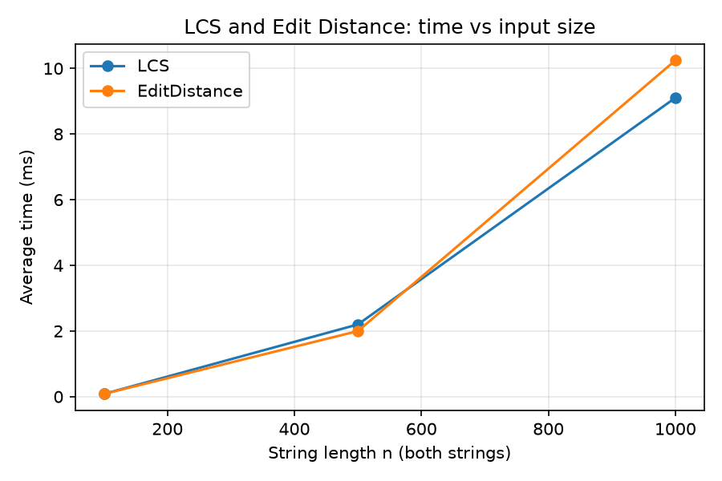
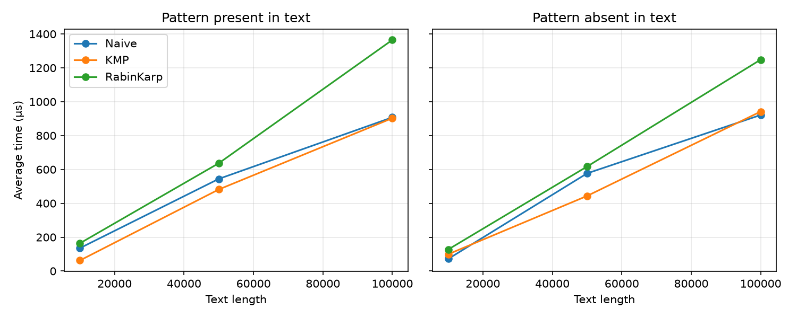
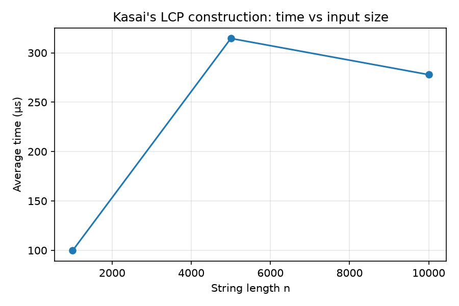

# Assignment 4 — Text Analysis: Dynamic Programming and String Algorithms

Java implementation, complexity analysis and experimental comparison of dynamic-programming
and string algorithms.

## How to build and run

Requires JDK 17+. Python 3 + matplotlib are needed only for the plots.

```bash
# from the repository root
mkdir -p out
javac -d out src/main/java/textanalysis/*.java src/test/java/textanalysis/*.java

java -cp out textanalysis.Tests        # run all tests (exit code 1 if any fails)
java -cp out textanalysis.Benchmark    # run experiments -> results/*.csv
python3 scripts/plot.py                # plots/*.png and results/tables.md
```

Repository layout:

```
src/main/java/textanalysis/   Lcs, EditDistance, StringMatching (Naive/KMP/Rabin-Karp), Kasai, Benchmark
src/test/java/textanalysis/   Tests (dependency-free test runner)
scripts/plot.py               plots + markdown tables from the CSV results
results/                      dp.csv, matching.csv, kasai.csv, tables.md
plots/                        dp_time.png, matching_time.png, kasai_time.png
```

## 1. Problem description and algorithm overview

| Part | Algorithm      | Problem                                                                                     |
|------|----------------|---------------------------------------------------------------------------------------------|
| A    | LCS            | Length of the longest subsequence common to two strings.                                    |
| A    | Edit Distance  | Minimum number of insertions, deletions and substitutions turning one string into another.  |
| B    | Naive matching | Try every alignment of the pattern against the text (baseline).                             |
| B    | KMP            | Precompute the pattern's LPS (prefix) table so the text pointer never moves backwards.      |
| B    | Rabin–Karp     | Compare a rolling hash of each text window with the pattern's hash; verify on equal hashes. |
| C    | Kasai          | Build the LCP array from a string and its suffix array in linear time.                      |

**Why the recurrences are correct.**

*LCS.* `dp[i][j]` is the LCS length of the prefixes `a[0..i)` and `b[0..j)`. With an empty prefix nothing
can be shared, so `dp[0][j] = dp[i][0] = 0`. If `a[i-1] == b[j-1]`, some optimal common subsequence can
end with that character (matching the two last characters never hurts), so `dp[i][j] = dp[i-1][j-1] + 1`.
Otherwise, at least one of the two last characters is not used, so the answer is the better of dropping
one of them: `max(dp[i-1][j], dp[i][j-1])`. Every cell depends only on cells with smaller indices, so
filling row by row is valid.

*Edit distance.* `dp[i][j]` is the minimum number of edits turning `a[0..i)` into `b[0..j)`. Base cases:
`dp[i][0] = i` (delete `i` characters) and `dp[0][j] = j` (insert `j` characters). If the last characters
are equal, no edit is needed for them: `dp[i][j] = dp[i-1][j-1]`. Otherwise, the last operation is one of
substitute (`dp[i-1][j-1]`), delete `a[i-1]` (`dp[i-1][j]`) or insert `b[j-1]` (`dp[i][j-1]`); we take the
cheapest and add 1. The three cases cover every possible last operation, so the minimum is correct.

*LPS and KMP.* `lps[i]` is the length of the longest proper prefix of `p[0..i]` that is also a suffix of it.
When a mismatch happens after `j` matched characters, the last `j` text characters equal `p[0..j)`.
The longest prefix of the pattern that can still be a suffix of that matched text is exactly `lps[j-1]`,
so the search continues with `j = lps[j-1]` instead of re-reading text. The text index `i` only ever moves
forward, so no text character is compared more than a bounded number of times: each mismatch strictly
decreases `j`, and `j` increases at most once per text character, so total fall-backs are at most `n`.

*Rabin–Karp.* Each window is encoded as a polynomial hash modulo a prime:
`h = (t[i]·B^(m-1) + … + t[i+m-1]) mod M`. Moving the window one-step removes the leading term and adds
the new character in O(1). Equal strings always have equal hashes, so no occurrence is missed. The
converse is not true (collisions), so whenever the hashes are equal the code compares the characters one
by one; only a full character match is reported. Collisions therefore cost time, never correctness.
The code counts them as "false matches".

*LCP array.* With the suffix array `SA` (suffix start positions in lexicographic order),
`lcp[i]` is the length of the longest common prefix of the suffixes `SA[i-1]` and `SA[i]`
(`lcp[0] = 0` by convention). It tells how much neighboring suffixes share: it is used for repeated
substrings (the maximum of `lcp` is the length of the longest repeated substring), distinct substring
counting, and fast pattern search in a suffix array.

*Kasai.* Process suffixes in text order `i = 0, 1, …` and let `k` be the suffix just before suffix `i` in
sorted order. Suppose they share `h > 0` characters. Then suffixes `i+1` and `k+1` share `h-1` characters
and `k+1` is still smaller than `i+1`, so the predecessor of suffix `i+1` shares **at least** `h-1`
characters with it. Therefore, the scan for suffix `i+1` can start at `h-1` instead of 0.

## 2. Implementation decisions and assumptions

- **Alphabet:** `abcd` (4 lowercase letters) for all randomly generated strings, fixed seed `42`
  (`java.util.Random`). A small alphabet makes partial matches (and so the algorithms' differences) more visible
  than a large one.
- **Empty pattern:** every matcher returns an **empty list** (an empty pattern has no meaningful starting index).
  A pattern longer than the text also returns an empty list.
- **Occurrences** include overlapping ones (`"aa"` in `"aaaa"` gives `[0, 1, 2]`).
- **LCS / Edit Distance** return only the value (not the subsequence/edit script) and use the full
  `(n+1) × (m+1)` table, as the assignment asks for a DP table.
- **Rabin–Karp** uses base 256 and modulus 1 000 000 007; all arithmetic is in `long` (maximum intermediate value
  is about 2.6·10¹¹, no overflow). Equal hashes are always verified character by character.
- **Kasai** takes the string and a suffix array. `Kasai.simpleSuffixArray` (comparison sort of the suffixes) is a helper
  used only to prepare inputs for tests and experiments; it is not part of the timed region.
- **Operation counts** are kept in static counters: DP cells filled for LCS/Edit Distance, character comparisons for
  Naive, KMP (including the LPS build), Kasai, and Rabin–Karp. For Rabin–Karp the count includes only the verification
  comparisons after a hash match; hash updates are not counted, so its count is not directly comparable to the others.
  Counts come from a separate run before timing.
- **Tests** use a small dependency-free runner (`Tests.java`) instead of JUnit, so the project compiles with only a JDK.

## 3. Complexity analysis

Notation: `n`, `m` are the lengths of the two strings (for matching: `n` is the text, `m` the pattern); `occ` is the number of occurrences.

| Algorithm      | Main operation / recurrence                                              | Best case                                         | Worst case                                                          | Auxiliary space | Justification                                                                                                                                                                                                                 |
|----------------|--------------------------------------------------------------------------|---------------------------------------------------|---------------------------------------------------------------------|-----------------|-------------------------------------------------------------------------------------------------------------------------------------------------------------------------------------------------------------------------------|
| LCS            | `dp[i][j] = dp[i-1][j-1]+1` if equal, else `max(dp[i-1][j], dp[i][j-1])` | Θ(nm)                                             | Θ(nm)                                                               | Θ(nm)           | The `(n+1)(m+1)` table is always filled completely with O(1) work per cell; the table itself is the space. (Only the length is needed, so two rows would give O(min(n,m)), not implemented.)                                  |
| Edit Distance  | `dp[i][j] = dp[i-1][j-1]` if equal, else `1 + min(sub, del, ins)`        | Θ(nm)                                             | Θ(nm)                                                               | Θ(nm)           | Same table-filling argument; the base row and column cost O(n+m).                                                                                                                                                             |
| Naive matching | Compare the pattern with every window of the text                        | Θ(n) (first character mismatches in every window) | Θ(nm) (e.g. text `aaaa…a`, pattern `aaa…ab`)                        | O(1)            | There are `n-m+1` windows; each costs 1 to `m` comparisons.                                                                                                                                                                   |
| KMP            | Build `lps`, then scan the text, falling back with `j = lps[j-1]`        | Θ(n+m)                                            | Θ(n+m)                                                              | Θ(m)            | LPS build is O(m) and search O(n): `j` grows at most once per text character, and each fall-back shrinks it, so fall-backs ≤ n. The `lps` array has `m` entries.                                                              |
| Rabin–Karp     | Rolling hash `h' = ((h − t[i]·B^(m-1))·B + t[i+m]) mod M`                | Θ(n+m) expected                                   | Θ(nm) (e.g. all windows hash-equal, or text `aaaa`, pattern `aaaa`) | O(1)            | Hash of pattern and first window: O(m); each roll is O(1), so O(n) in total. A verification costs O(m) but happens only for equal hashes: expected O(n+m) when collisions are rare, O(nm) when many windows match or collide. |
| Kasai (LCP)    | `while s[i+h] == s[sa[rank[i]-1]+h]: h++`, then `h = max(h-1, 0)`        | Θ(n)                                              | Θ(n)                                                                | Θ(n)            | `h` is at most `n`, drops by at most 1 per iteration (≤ n total decreases), so it can increase at most `n + n = 2n` times: total O(n). Needs the `rank` and `lcp` arrays (the suffix array is an input).                      |

**Theory vs. measurement.** The table gives asymptotic growth, which is independent of the machine and of the input
constants. The measured times in Section 6 depend on the CPU, the JIT compiler, the memory system and on the input data
(random strings here, which do not trigger the worst cases). For Rabin–Karp and Naive, best/expected and worst-case bounds
differ: random text makes mismatches appear within the first one or two characters, so Naive behaves like Θ(n) in practice,
and Rabin–Karp's collisions are so rare (probability about 1/M per window) that verification almost never runs.

## 4. Testing strategy and results

`java -cp out textanalysis.Tests` runs 48 checks (all pass):

- **LCS:** identical strings (`abcde`/`abcde` → 5), completely different (`abc`/`xyz` → 0), empty string in either position, classic `AGGTAB`/`GXTXAYB` → 4.
- **Edit Distance:** identical → 0; empty vs `abc` and `abc` vs empty → 3; substitution `cat→cut` = 1; insertion `cat→cart` = 1; deletion `cart→cat` = 1; `kitten→sitting` = 3.
- **String matching** (each case is checked for Naive, KMP and Rabin–Karp **separately and for mutual agreement**): pattern at the beginning, in the middle and at the end; multiple and overlapping occurrences; pattern absent; pattern longer than the text; empty pattern (empty list). Additionally, 500 random text/pattern pairs over the alphabet `ab` are compared with an independent reference built on `String.startsWith`.
- **Kasai:** `banana` with the manually verified suffix array `[5, 3, 1, 0, 4, 2]`. Sorted suffixes: `a`, `ana`, `anana`, `banana`, `na`, `nana`. Neighbor LCPs: `a/ana = 1`, `ana/anana = 3`, `anana/banana = 0`, `banana/na = 0`, `na/nana = 2`, so the expected LCP array is `[0, 1, 3, 0, 0, 2]`. Both the simple suffix-array builder and Kasai's output are checked against these arrays. Another 200 random strings are compared with a brute-force LCP.

The benchmark also checks, before timing every string-matching input, that Naive, KMP and Rabin–Karp return identical index lists.

## 5. Experimental setup

| Experiment         | Input sizes                                                                     |
|--------------------|---------------------------------------------------------------------------------|
| LCS, Edit Distance | two random strings of length 100, 500, 1 000                                    |
| String matching    | random text of length 10 000, 50 000, 100 000; pattern length 20                |
| Kasai              | random string of length 1 000, 5 000, 10 000 (suffix array prepared beforehand) |

- **Alphabet:** `abcd`; **random seed:** 42. The same strings are used for all algorithms solving the same task.
- **Patterns:** *present* = a 20-character substring cut from the middle of the text; *absent* = a random 20-character string, regenerated until the naive matcher confirms it does not occur.
- **Timing:** `System.nanoTime()` around a single call; **each measurement is the average of 5 runs**.
  Input generation, operation counting, console output and file writing are outside the timed regions.
- **JIT warm-up:** the Java JIT compiler makes the first executions much slower. The whole suite is therefore executed once with
  results discarded, and each measurement also has 2 untimed warm-up calls. Only the second pass is reported.
- Results were produced by running `textanalysis.Benchmark` on the author's computer. Absolute times depend on the machine and
  vary between runs (especially at the microsecond scale); operation counts are deterministic.

## 6. Results

**LCS and Edit Distance** (average of 5 runs)

|    n | LCS time (µs) | Edit Distance time (µs) | DP cells filled (n²) |
|-----:|--------------:|------------------------:|---------------------:|
|  100 |          81.3 |                    82.9 |                10000 |
|  500 |        2199.4 |                  1997.3 |               250000 |
| 1000 |        9105.1 |                 10244.9 |              1000000 |

**String matching, time** (average of 5 runs, pattern length 20)

| Text length | Pattern | Naive (µs) | KMP (µs) | Rabin–Karp (µs) | Occurrences |
|------------:|---------|-----------:|---------:|----------------:|------------:|
|       10000 | present |      135.3 |     62.5 |           163.8 |           1 |
|       10000 | absent  |       71.7 |     99.3 |           127.3 |           0 |
|       50000 | present |      544.3 |    481.8 |           636.7 |           1 |
|       50000 | absent  |      576.8 |    443.6 |           617.1 |           0 |
|      100000 | present |      907.7 |    902.9 |          1365.1 |           1 |
|      100000 | absent  |      921.6 |    941.9 |          1248.6 |           0 |

**String matching, operation counts** (character comparisons, one run)

| Text length | Pattern |  Naive | KMP (incl. LPS build) | Rabin–Karp (verification only) | Rabin–Karp false hash matches |
|------------:|---------|-------:|----------------------:|-------------------------------:|------------------------------:|
|       10000 | present |  13353 |                 12471 |                             20 |                             0 |
|       10000 | absent  |  13283 |                 12559 |                              0 |                             0 |
|       50000 | present |  66588 |                 61685 |                             20 |                             0 |
|       50000 | absent  |  66547 |                 62476 |                              0 |                             0 |
|      100000 | present | 132854 |                124298 |                             20 |                             0 |
|      100000 | absent  | 133113 |                124785 |                              0 |                             0 |

**Kasai's algorithm** (average of 5 runs; suffix array built beforehand, not timed)

|     n | Time (µs) | Character comparisons |
|------:|----------:|----------------------:|
|  1000 |      99.7 |                  1990 |
|  5000 |     314.6 |                  9988 |
| 10000 |     277.9 |                 19988 |

Plots (included in the repository):







## 7. Discussion: theory vs. experiment

- **LCS and Edit Distance.** Both fill an `n × n` table, so cell counts grow as `n²`: 10 000 → 250 000 → 1 000 000. The measured times
  follow the same shape: from n=100 to n=500 (25× more cells) the time grew about 24–27×, and from 500 to 1 000 (4× more cells) about 4–5×.
  The two algorithms have similar times (within roughly 10–15% of each other, with no consistent winner) because they have the same Θ(nm)
  table structure and a similar O(1) cost per cell.
  The time is also dominated by memory use: a 1 000 × 1 000 `int` table is about 4 MB.
- **String matching is roughly linear for all three algorithms** in these experiments: from text length 10 000 to 100 000 the time grows
  by about 7–14×, and the 10 000 point is the noisiest because it takes only tens to hundreds of microseconds.
  *Naive and KMP are close.* At 100 000 their times are within a few percent of each other, and at 50 000 KMP was somewhat faster (roughly 10–25%). On random text over 4 letters a window mismatches after about 1.33 comparisons on average,
  so Naive does about `1.33n` comparisons (133 113 for n = 100 000), almost the same as KMP (124 785, including the LPS build).
  KMP saves a few comparisons, but each step also reads and updates the `lps` table, which cancels most of the saving. KMP's advantage is its
  *guarantee* of O(n+m) on any input; these random inputs never trigger the Naive worst case Θ(nm).
- **Rabin–Karp does by far the fewest character comparisons** (20 for a present pattern, 0 for an absent one: verification only happens on
  hash matches, and there were no false matches) **but is the slowest at 50 000 and 100 000, roughly 1.1–1.5× slower than Naive and KMP.** The reason is that every text position
  costs several modular multiplications/reductions for the rolling hash, which is more expensive than one or two character comparisons.
  This is a case where the operation count and the wall-clock time disagree: Big-O ignores constants, and operation counts only count what
  was chosen to be counted.
- **Present vs. absent pattern:** there is no systematic difference, because every algorithm has to scan the whole text to report *all* occurrences
  (the larger gaps at text length 10 000 are measurement noise).
- **Kasai.** The number of character comparisons is 1 990, 9 988 and 19 988 for n = 1 000, 5 000, 10 000, i.e. about `2n`, which matches the
  analysis (at most `2n` increments of `h`). The measured time is not a clean line: 99.7 → 314.6 → 277.9 µs, i.e. it even dropped between n = 5 000 and n = 10 000. At these sizes
  (about 0.1–0.3 ms) the timing is dominated by noise (JIT, garbage collection, timer resolution), so the deterministic comparison count is the
  reliable evidence of linear behavior here, not the stopwatch.
- **Caveat.** These are micro-benchmarks of a few hundred microseconds: JIT compilation, garbage collection and CPU frequency affect them.
  Conclusions rely on trends (growth rate, ratios between algorithms), not on exact values.

## 8. Conclusion: main trade-offs

- **LCS / Edit Distance:** Θ(nm) time and space, regardless of the input. The recurrences are simple and always correct;
  the price is the quadratic table. If only the final value is needed, keeping two rows reduces the space to O(min(n, m)) (at the cost of
  not being able to reconstruct the subsequence or the edit script).
- **Naive:** simplest code, O(1) extra space and very fast on random text, but Θ(nm) in the worst case (repetitive text/pattern).
- **KMP:** guaranteed O(n+m) time for any input, with Θ(m) extra space and more complex code. The best choice when worst-case behavior or
  adversarial/repetitive inputs matter; little or no consistent speed-up on random text.
- **Rabin–Karp:** simple, O(1) extra space, expected O(n+m); few character comparisons, but the hashing arithmetic makes it slower per position
  for a single pattern, and its worst case is Θ(nm). Its strength is that the hash can be reused, e.g. for searching many patterns of the same length at once.
- **Kasai:** O(n) time and O(n) space to obtain the LCP array once the suffix array is known. The total cost of an application depends on
  the suffix-array construction, which was not part of this assignment (the simple sorting method used here is only suitable for small inputs).